<!-- Assets generated by tools/render_profile.py. -->

<picture>
  <source media="(prefers-reduced-motion: reduce) and (max-width: 560px)" srcset="./assets/terminal/hero-mobile-static.svg">
  <source media="(prefers-reduced-motion: reduce)" srcset="./assets/terminal/hero-static.svg">
  <source media="(max-width: 560px)" srcset="./assets/terminal/hero-mobile.svg">
  
</picture>

  <a href="https://site-six-gules-60.vercel.app"><picture><source media="(max-width: 560px)" srcset="./assets/terminal/button-portfolio-mobile.svg"></picture></a>
  <a href="https://www.linkedin.com/in/gabrielmsas/"><picture><source media="(max-width: 560px)" srcset="./assets/terminal/button-linkedin-mobile.svg"></picture></a>
  <a href="https://github.com/ryuclover/Guia-dos-meus-projetos"><picture><source media="(max-width: 560px)" srcset="./assets/terminal/button-guide-mobile.svg"></picture></a>

## Projetos em destaque

<a href="https://github.com/ryuclover/Olympus-painel">
<picture>
  <source media="(prefers-reduced-motion: reduce) and (max-width: 560px)" srcset="./assets/terminal/project-olympus-mobile-static.svg">
  <source media="(prefers-reduced-motion: reduce)" srcset="./assets/terminal/project-olympus-static.svg">
  <source media="(max-width: 560px)" srcset="./assets/terminal/project-olympus-mobile.svg">
  
</picture>
</a>

<a href="https://github.com/ryuclover/wide-studio">
<picture>
  <source media="(prefers-reduced-motion: reduce) and (max-width: 560px)" srcset="./assets/terminal/project-wide-mobile-static.svg">
  <source media="(prefers-reduced-motion: reduce)" srcset="./assets/terminal/project-wide-static.svg">
  <source media="(max-width: 560px)" srcset="./assets/terminal/project-wide-mobile.svg">
  
</picture>
</a>

<a href="https://github.com/ryuclover/photopea-ai-studio">
<picture>
  <source media="(prefers-reduced-motion: reduce) and (max-width: 560px)" srcset="./assets/terminal/project-photopea-mobile-static.svg">
  <source media="(prefers-reduced-motion: reduce)" srcset="./assets/terminal/project-photopea-static.svg">
  <source media="(max-width: 560px)" srcset="./assets/terminal/project-photopea-mobile.svg">
  
</picture>
</a>

<a href="https://github.com/ryuclover/BeeHost">
<picture>
  <source media="(prefers-reduced-motion: reduce) and (max-width: 560px)" srcset="./assets/terminal/project-beehost-mobile-static.svg">
  <source media="(prefers-reduced-motion: reduce)" srcset="./assets/terminal/project-beehost-static.svg">
  <source media="(max-width: 560px)" srcset="./assets/terminal/project-beehost-mobile.svg">
  
</picture>
</a>

<a href="https://github.com/ryuclover/Fast-Travel">
<picture>
  <source media="(prefers-reduced-motion: reduce) and (max-width: 560px)" srcset="./assets/terminal/project-fast-mobile-static.svg">
  <source media="(prefers-reduced-motion: reduce)" srcset="./assets/terminal/project-fast-static.svg">
  <source media="(max-width: 560px)" srcset="./assets/terminal/project-fast-mobile.svg">
  
</picture>
</a>

<a href="https://github.com/ryuclover/Serapeu">
<picture>
  <source media="(prefers-reduced-motion: reduce) and (max-width: 560px)" srcset="./assets/terminal/project-serapeu-mobile-static.svg">
  <source media="(prefers-reduced-motion: reduce)" srcset="./assets/terminal/project-serapeu-static.svg">
  <source media="(max-width: 560px)" srcset="./assets/terminal/project-serapeu-mobile.svg">
  
</picture>
</a>

<a href="https://github.com/ryuclover/Masquerada">
<picture>
  <source media="(prefers-reduced-motion: reduce) and (max-width: 560px)" srcset="./assets/terminal/project-masquerada-mobile-static.svg">
  <source media="(prefers-reduced-motion: reduce)" srcset="./assets/terminal/project-masquerada-static.svg">
  <source media="(max-width: 560px)" srcset="./assets/terminal/project-masquerada-mobile.svg">
  
</picture>
</a>

**[Explorar todos os projetos →](https://github.com/ryuclover/Guia-dos-meus-projetos)**

<picture>
  <source media="(prefers-reduced-motion: reduce) and (max-width: 560px)" srcset="./assets/terminal/stack-mobile-static.svg">
  <source media="(prefers-reduced-motion: reduce)" srcset="./assets/terminal/stack-static.svg">
  <source media="(max-width: 560px)" srcset="./assets/terminal/stack-mobile.svg">
  
</picture>

Índice dos projetos em texto

- **[Olympus Painel](https://github.com/ryuclover/Olympus-painel)** — Da descoberta de empresas à gestão comercial. Leads, mapa, Kanban, reuniões e contratos.
- **[Wide Studio](https://github.com/ryuclover/wide-studio)** — Um novo fluxo de edição para o wide.video. Drive público, importações e clipes vinculados.
- **[Photopea AI Studio](https://github.com/ryuclover/photopea-ai-studio)** — Da seleção do canvas a uma nova camada. Edição com IA, prévia e ajustes de borda.
- **[BeeHost](https://github.com/ryuclover/BeeHost)** — Do checkout PIX ao servidor Minecraft. Vitrine, provisionamento e painel do cliente.
- **[Fast-Travel](https://github.com/ryuclover/Fast-Travel)** — Menos abas. Mais caminhos para viajar. Comparação de passagens e busca ID Jovem.
- **[Serapeu](https://github.com/ryuclover/Serapeu)** — Conhecimento que vira passo a passo. Tutoriais, comunidade e controle de acesso.
- **[Masquerada](https://github.com/ryuclover/Masquerada)** — Conexões entre pessoas, de ponto a ponto. Mensagens, voz, tela e histórico local.

Mais projetos: **Clicktube**, **Pixelboard**, **mangator**, **Cornucopia**, **Módulo Mercado Pago**, **Projeto Korp**, **HÔTE** e meu **portfólio pessoal**. [Arquitetura, tecnologias e guias de execução](https://github.com/ryuclover/Guia-dos-meus-projetos).

<a href="https://www.linkedin.com/in/gabrielmsas/">
<picture>
  <source media="(prefers-reduced-motion: reduce) and (max-width: 560px)" srcset="./assets/terminal/contact-mobile-static.svg">
  <source media="(prefers-reduced-motion: reduce)" srcset="./assets/terminal/contact-static.svg">
  <source media="(max-width: 560px)" srcset="./assets/terminal/contact-mobile.svg">
  
</picture>
</a>
