<!-- Assets generated by tools/render_profile.py. -->

<picture>
  <source media="(max-width: 560px)" srcset="./assets/terminal/hero-mobile.svg?v=5">
  
</picture>

  <a href="https://site-six-gules-60.vercel.app"><picture><source media="(max-width: 560px)" srcset="./assets/terminal/button-portfolio-mobile.svg"></picture></a>
  <a href="https://www.linkedin.com/in/gabrielmsas/"><picture><source media="(max-width: 560px)" srcset="./assets/terminal/button-linkedin-mobile.svg"></picture></a>

<a href="https://github.com/ryuclover/Guia-dos-meus-projetos">
<picture>
  <source media="(max-width: 560px)" srcset="./assets/terminal/guide-mobile.svg?v=5">
  
</picture>
</a>

## Projetos em destaque

<a href="https://github.com/ryuclover/Olympus-painel">
<picture>
  <source media="(max-width: 560px)" srcset="./assets/terminal/project-olympus-mobile.svg?v=5">
  
</picture>
</a>

<a href="https://github.com/ryuclover/wide-studio">
<picture>
  <source media="(max-width: 560px)" srcset="./assets/terminal/project-wide-mobile.svg?v=5">
  
</picture>
</a>

<a href="https://github.com/ryuclover/photopea-ai-studio">
<picture>
  <source media="(max-width: 560px)" srcset="./assets/terminal/project-photopea-mobile.svg?v=5">
  
</picture>
</a>

<a href="https://github.com/ryuclover/BeeHost">
<picture>
  <source media="(max-width: 560px)" srcset="./assets/terminal/project-beehost-mobile.svg?v=5">
  
</picture>
</a>

<a href="https://github.com/ryuclover/Fast-Travel">
<picture>
  <source media="(max-width: 560px)" srcset="./assets/terminal/project-fast-mobile.svg?v=5">
  
</picture>
</a>

<a href="https://github.com/ryuclover/Serapeu">
<picture>
  <source media="(max-width: 560px)" srcset="./assets/terminal/project-serapeu-mobile.svg?v=5">
  
</picture>
</a>

<a href="https://github.com/ryuclover/Masquerada">
<picture>
  <source media="(max-width: 560px)" srcset="./assets/terminal/project-masquerada-mobile.svg?v=5">
  
</picture>
</a>

<picture>
  <source media="(max-width: 560px)" srcset="./assets/terminal/stats-mobile.svg?v=5">
  
</picture>

<picture>
  <source media="(max-width: 560px)" srcset="./assets/terminal/tools-mobile.svg?v=5">
  
</picture>

